# Sample file GenericTestAllStyles2+ja.imscr


This sample is very preliminary, and may not be accurate.  Please refer to the alignment and boxing samples for accurate samples.

This file is an overall sample which demonstrates all the features of imsc-rosetta


## Complete file (click expand to see all) [download](./imscr/GenericTestAllStyles2+ja.imscr)


## Divs with images:


### subtitle e_0 at begin=01:00:03.600


This div represents a single line of boxed text at the bottom of the screen.

It's white text on black box, with black outline.


#### div XML

```
<div xml:id="e_0" region="R0" begin="01:00:03.600" end="01:00:07.640" style="d_default">
   <metadata rosetta:comment="this is a comment test a cr"/>
   <p style="p_font2 p_rb_res_outside"><span style="ps_bg_boxedblack">First Frame of active video </span></p>
  </div>
```
#### Resulting Image


### subtitle e_1 at begin=01:00:07.760

#### div XML

```
<div xml:id="e_1" region="R0" begin="01:00:07.760" end="01:00:11.760" style="d_default d_none">
   <p style="p_font2 p_rb_res_outside"><span>1 line</span><span style="s_nonered"> Center</span><span> Bottom</span></p>
  </div>
```
#### Resulting Image


### subtitle e_2 at begin=01:00:11.880

#### div XML

```
<div xml:id="e_2" region="R0" begin="01:00:11.880" end="01:00:15.880" style="d_default">
   <p style="p_font2 p_al_start p_rb_res_outside"><span>1 line left  bottom</span></p>
  </div>
```
#### Resulting Image


### subtitle e_3 at begin=01:00:16.000

#### div XML

```
<div xml:id="e_3" region="R0" begin="01:00:16.000" end="01:00:20.000" style="d_default">
   <p style="p_font2 p_al_end p_rb_res_outside"><span>1 line right bottom</span></p>
  </div>
```
#### Resulting Image


### subtitle e_4 at begin=01:00:20.120


This div represents a two line subtitle at the bottom of the screen.  The subtitle is centered and has black outline because d_outline is specified in _d_default.


#### div XML

```
<div xml:id="e_4" region="R0" begin="01:00:20.120" end="01:00:24.120" style="d_default">
   <p style="p_font2 p_rb_res_outside"><span>two line </span></p>
   <p style="p_font2 p_rb_res_outside"><span>center bottom</span></p>
  </div>
```
#### Resulting Image

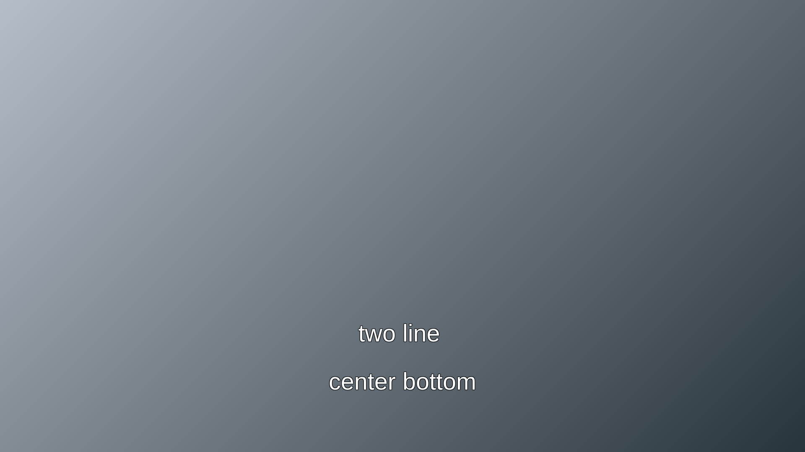


### subtitle e_5 at begin=01:00:24.240

#### div XML

```
<div xml:id="e_5" region="R0" begin="01:00:24.240" end="01:00:28.240" style="d_default">
   <p style="p_font2 p_al_start p_rb_res_outside"><span>two lines</span></p>
   <p style="p_font2 p_al_start p_rb_res_outside"><span>left bottom</span></p>
  </div>
```
#### Resulting Image

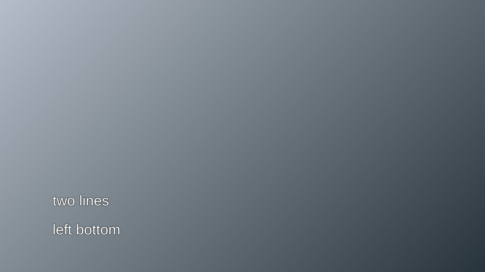


### subtitle e_6 at begin=01:00:28.360

#### div XML

```
<div xml:id="e_6" region="R0" begin="01:00:28.360" end="01:00:32.360" style="d_default">
   <p style="p_font2 p_al_end p_rb_res_outside"><span>two lines</span></p>
   <p style="p_font2 p_al_end p_rb_res_outside"><span>right bottom</span></p>
  </div>
```
#### Resulting Image


### subtitle e_7 at begin=01:00:32.480

#### div XML

```
<div xml:id="e_7" region="R0" begin="01:00:32.480" end="01:00:36.480" style="d_default">
   <p style="p_font2 p_rb_res_outside"><span>row 11</span></p>
  </div>
```
#### Resulting Image

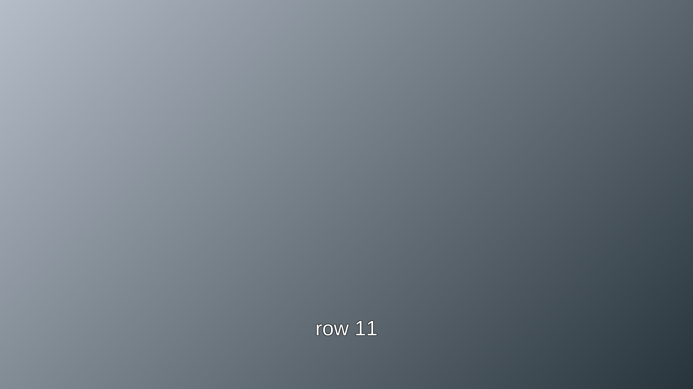


### subtitle e_8 at begin=01:00:36.640

#### div XML

```
<div xml:id="e_8" region="R1" begin="01:00:36.640" end="01:00:40.640" style="d_default">
   <p style="p_font2 p_rb_res_outside"><span>row 10</span></p>
  </div>
```
#### Resulting Image

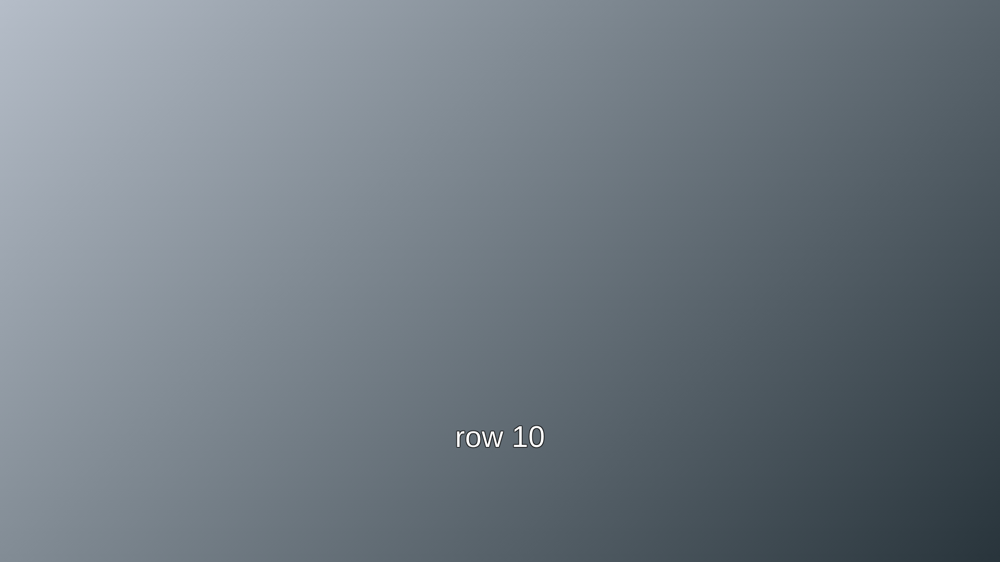


### subtitle e_9 at begin=01:00:40.760

#### div XML

```
<div xml:id="e_9" region="R2" begin="01:00:40.760" end="01:00:44.760" style="d_default">
   <p style="p_font2 p_rb_res_outside"><span>row 9</span></p>
  </div>
```
#### Resulting Image

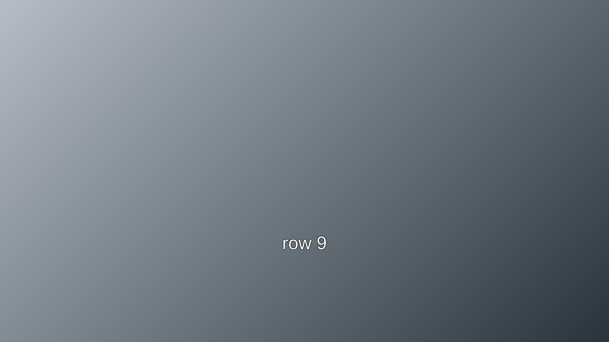


### subtitle e_10 at begin=01:00:44.880

#### div XML

```
<div xml:id="e_10" region="R3" begin="01:00:44.880" end="01:00:48.880" style="d_default">
   <p style="p_font2 p_rb_res_outside"><span>row 8</span></p>
  </div>
```
#### Resulting Image

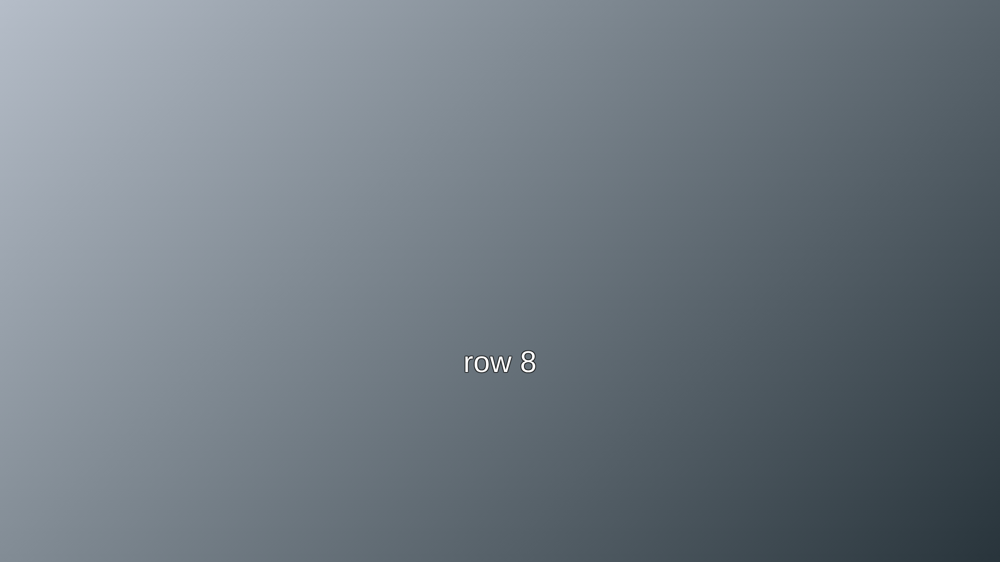


### subtitle e_11 at begin=01:00:49.000

#### div XML

```
<div xml:id="e_11" region="R4" begin="01:00:49.000" end="01:00:53.000" style="d_default">
   <p style="p_font2 p_rb_res_outside"><span>row 7</span></p>
  </div>
```
#### Resulting Image

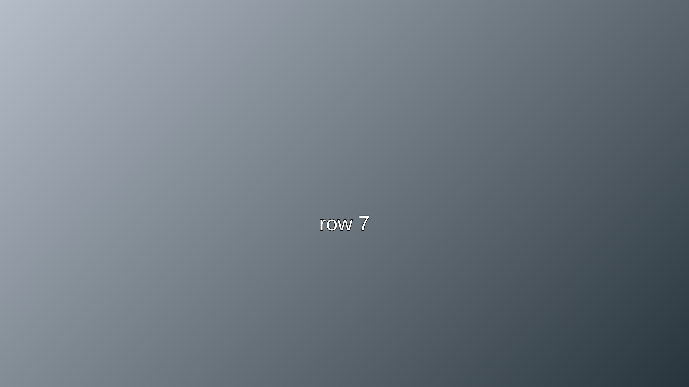


### subtitle e_12 at begin=01:00:53.120

#### div XML

```
<div xml:id="e_12" region="R5" begin="01:00:53.120" end="01:00:57.120" style="d_default">
   <p style="p_font2 p_rb_res_outside"><span>row 6</span></p>
  </div>
```
#### Resulting Image

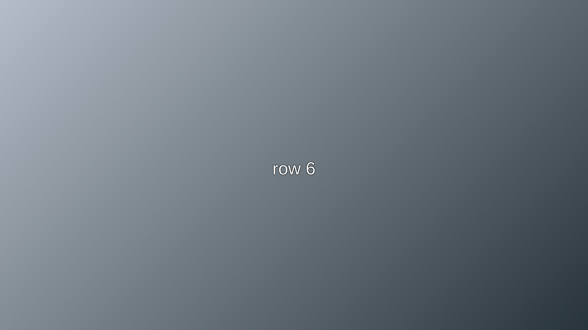


### subtitle e_13 at begin=01:00:57.240

#### div XML

```
<div xml:id="e_13" region="R6" begin="01:00:57.240" end="01:01:01.240" style="d_default">
   <p style="p_font2 p_rb_res_outside"><span>row 5</span></p>
  </div>
```
#### Resulting Image

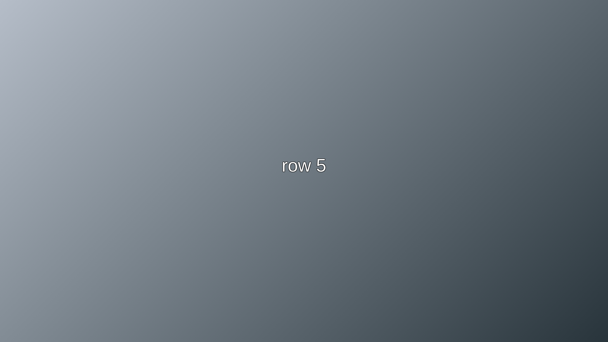


### subtitle e_14 at begin=01:01:01.360

#### div XML

```
<div xml:id="e_14" region="R7" begin="01:01:01.360" end="01:01:05.360" style="d_default">
   <p style="p_font2 p_rb_res_outside"><span>row 4</span></p>
  </div>
```
#### Resulting Image

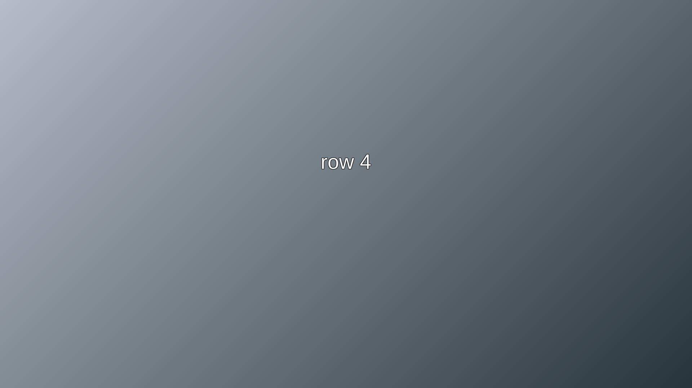


### subtitle e_15 at begin=01:01:05.480

#### div XML

```
<div xml:id="e_15" region="R8" begin="01:01:05.480" end="01:01:09.480" style="d_default">
   <p style="p_font2 p_rb_res_outside"><span>row 3</span></p>
  </div>
```
#### Resulting Image

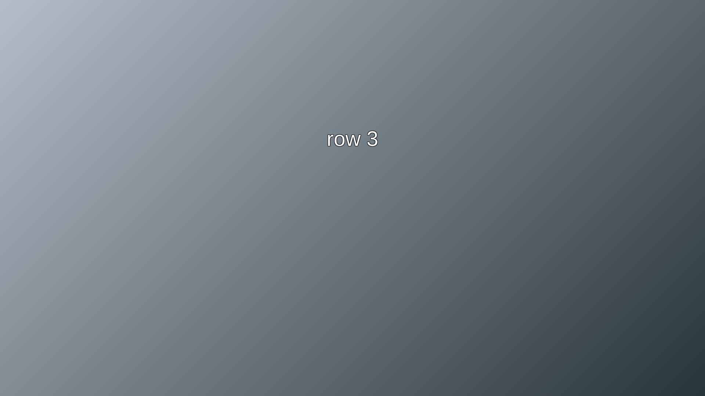


### subtitle e_16 at begin=01:01:09.640

#### div XML

```
<div xml:id="e_16" region="R9" begin="01:01:09.640" end="01:01:13.640" style="d_default">
   <p style="p_font2 p_rb_res_outside"><span>row 2</span></p>
  </div>
```
#### Resulting Image

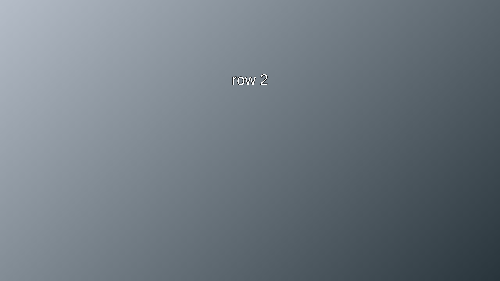


### subtitle e_17 at begin=01:01:13.760

#### div XML

```
<div xml:id="e_17" region="R10" begin="01:01:13.760" end="01:01:17.760" style="d_default">
   <p style="p_font2 p_rb_res_outside"><span>row 1</span></p>
  </div>
```
#### Resulting Image

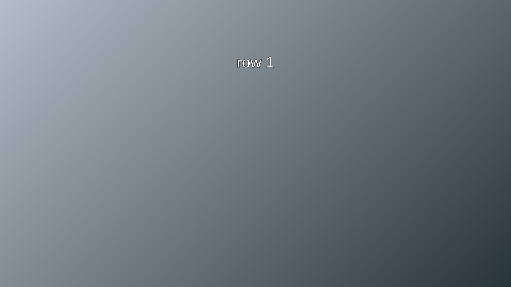


### subtitle e_18 at begin=01:01:17.880

#### div XML

```
<div xml:id="e_18" region="R11" begin="01:01:17.880" end="01:01:21.880" style="d_default">
   <p style="p_font2 p_rb_res_outside"><span>row 0</span></p>
  </div>
```
#### Resulting Image

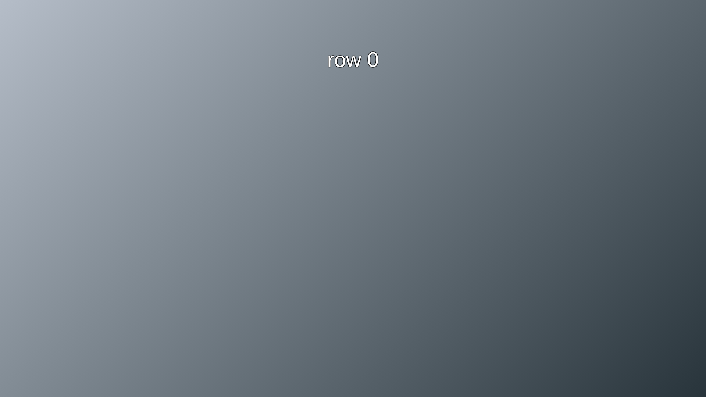


### subtitle e_19 at begin=01:01:22.000

#### div XML

```
<div xml:id="e_19" region="R11" begin="01:01:22.000" end="01:01:26.000" style="d_default">
   <p style="p_font2 p_rb_res_outside"><span>top center</span></p>
  </div>
```
#### Resulting Image


### subtitle e_20 at begin=01:01:26.120

#### div XML

```
<div xml:id="e_20" region="R11" begin="01:01:26.120" end="01:01:30.120" style="d_default">
   <p style="p_font2 p_al_start p_rb_res_outside"><span>top left</span></p>
  </div>
```
#### Resulting Image


### subtitle e_21 at begin=01:01:30.240

#### div XML

```
<div xml:id="e_21" region="R11" begin="01:01:30.240" end="01:01:34.240" style="d_default">
   <p style="p_font2 p_al_end p_rb_res_outside"><span>top right</span></p>
  </div>
```
#### Resulting Image


### subtitle e_22 at begin=01:01:34.360

#### div XML

```
<div xml:id="e_22" region="R0" begin="01:01:34.360" end="01:01:38.360" style="d_default">
   <p style="p_al_start p_font2 p_rb_res_outside"><span>left</span></p>
   <p style="p_font2 p_rb_res_outside"><span>center</span></p>
   <p style="p_al_end p_font2 p_rb_res_outside"><span>right</span></p>
  </div>
```
#### Resulting Image

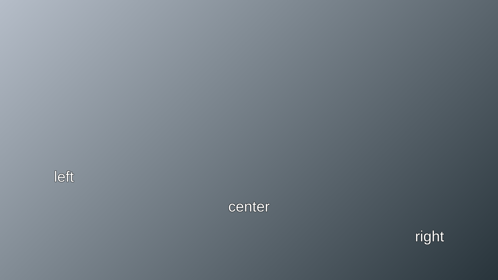


### subtitle e_23 at begin=01:01:38.520

#### div XML

```
<div xml:id="e_23" region="R0" begin="01:01:38.520" end="01:01:42.520" style="d_default">
   <p style="p_font2 p_rb_res_outside"><span>normal</span><span style="s_italic"> italic</span><span style="s_bold"> bold </span><span style="s_underline">underline</span><span> normal</span></p>
   <p style="p_font2 p_rb_res_outside"><span style="s_underline">underlined</span><span style="s_italic s_underline"> italic</span><span style="s_bold s_underline"> bold</span><span style="s_underline"> normal</span></p>
  </div>
```
#### Resulting Image

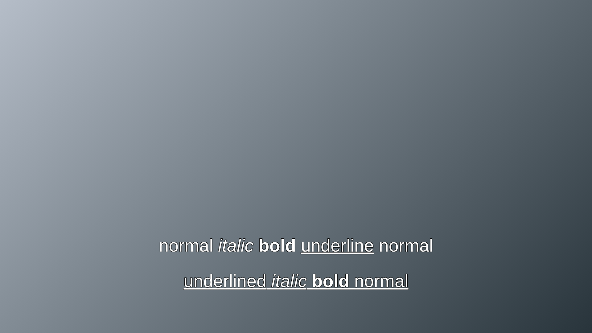


### subtitle e_24 at begin=01:01:42.640

#### div XML

```
<div xml:id="e_24" region="R0" begin="01:01:42.640" end="01:01:46.640" style="d_default">
   <p style="p_font2 p_rb_res_outside"><span style="s_fg_red">red </span><span style="s_fg_yellow">yellow </span><span style="s_fg_green">green </span><span style="s_fg_cyan">cyan </span><span style="s_fg_blue">blue </span><span style="s_fg_magenta">magenta</span></p>
  </div>
```
#### Resulting Image


### subtitle e_25 at begin=01:01:46.760

#### div XML

```
<div xml:id="e_25" region="R11" begin="01:01:46.760" end="01:01:50.760" style="d_default">
   <p style="p_font2 p_rb_res_outside"><span>Two lines </span></p>
   <p style="p_font2 p_rb_res_outside"><span>top center</span></p>
  </div>
```
#### Resulting Image

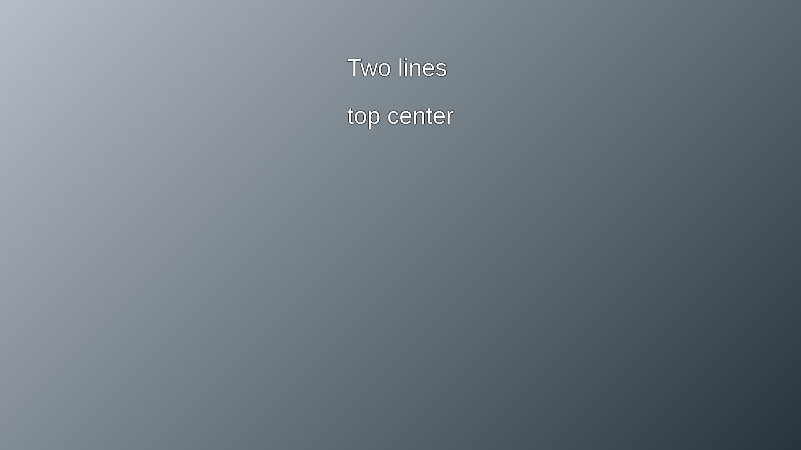


### subtitle e_26 at begin=01:01:50.880

#### div XML

```
<div xml:id="e_26" region="R0" begin="01:01:50.880" end="01:01:53.880" style="d_default d_none">
   <p style="p_font2 ps_bg_boxedblack p_rb_res_outside"><span style="s_noneblack">Background stripe</span></p>
   <p style="p_font2 ps_bg_boxedblack p_rb_res_outside"><span style="s_noneblack">black</span></p>
  </div>
```
#### Resulting Image

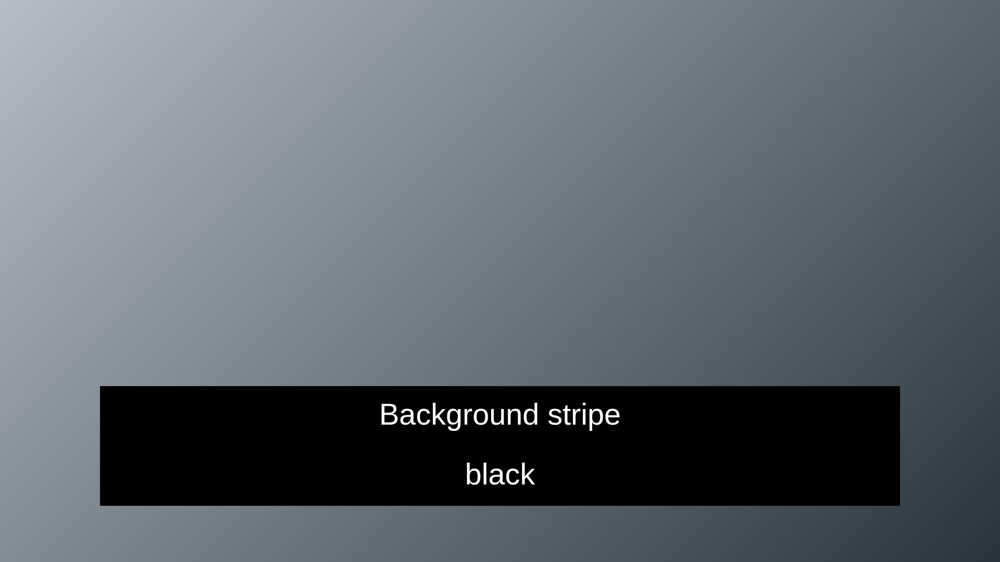


### subtitle e_27 at begin=01:01:54.000

#### div XML

```
<div xml:id="e_27" region="R0" begin="01:01:54.000" end="01:01:57.000" style="d_default">
   <p style="p_font2 p_rb_res_outside"><span style="ps_bg_boxedblack">black</span></p>
   <p style="p_font2 p_rb_res_outside"><span style="ps_bg_boxedblack">box</span></p>
  </div>
```
#### Resulting Image

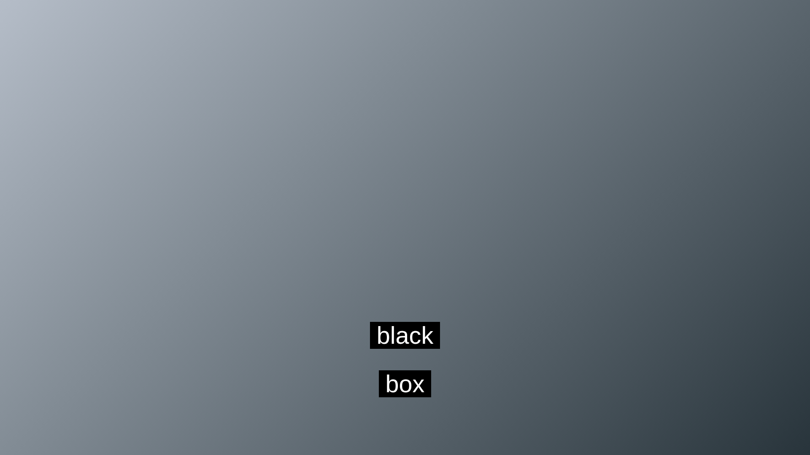


### subtitle e_28 at begin=01:01:57.120

#### div XML

```
<div xml:id="e_28" region="R0" begin="01:01:57.120" end="01:02:00.120" style="d_default">
   <p style="p_font2 p_rb_res_outside"><span style="ps_bg_ghostboxedblack">ghost</span></p>
   <p style="p_font2 p_rb_res_outside"><span style="ps_bg_ghostboxedblack">box</span></p>
  </div>
```
#### Resulting Image

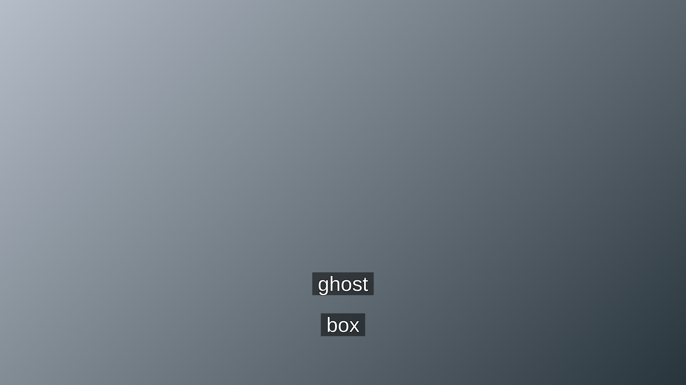


### subtitle e_29 at begin=01:02:00.240

#### div XML

```
<div xml:id="e_29" region="R0" begin="01:02:00.240" end="01:02:03.240" style="d_default d_none">
   <p style="p_font2 ps_bg_ghostboxedblack p_rb_res_outside"><span style="s_noneblack">Ghost stripe</span></p>
   <p style="p_font2 ps_bg_ghostboxedblack p_rb_res_outside"><span style="s_noneblack">black</span></p>
  </div>
```
#### Resulting Image

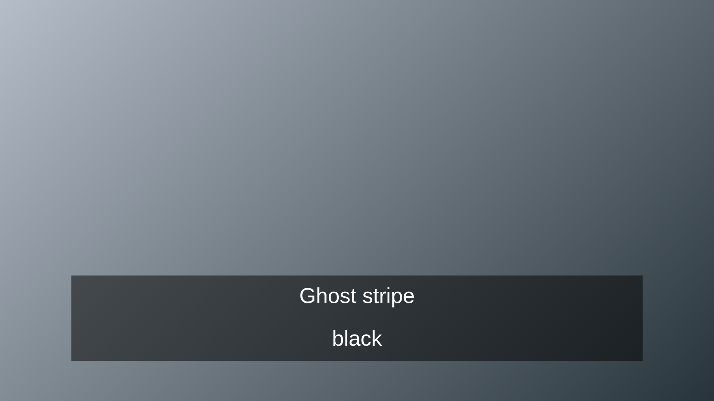


### subtitle e_30 at begin=01:02:03.359

#### div XML

```
<div xml:id="e_30" region="R0" begin="01:02:03.359" end="01:02:06.359" style="d_default d_none">
   <p style="p_font2 p_rb_res_outside"><span style="ps_bg_ghostboxedblack">Ghost box change to </span><span style="ps_bg_ghostboxedred s_nonered">red</span></p>
  </div>
```
#### Resulting Image


### subtitle e_38 at begin=01:02:35.120

#### div XML

```
<div xml:id="e_38" region="R0" begin="01:02:35.120" end="01:02:40.120" style="d_default">
   <p style="p_font2 p_al_center_start p_rb_res_outside"><span>two line</span><span><br/></span><span>center start bottom</span></p>
  </div>
```
#### Resulting Image

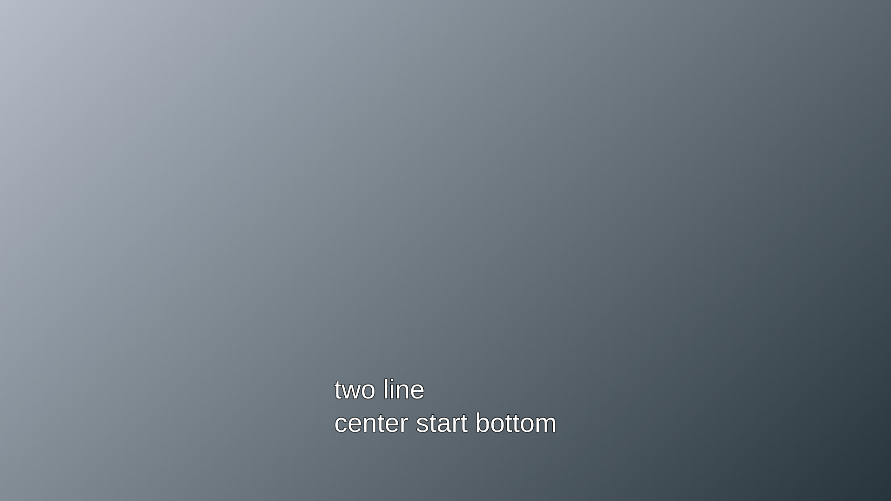


### subtitle e_39 at begin=01:02:41.120

#### div XML

```
<div xml:id="e_39" region="R0" begin="01:02:41.120" end="01:02:44.120" style="d_default">
   <p style="p_font2 p_al_center_start p_rb_res_outside"><span style="ps_bg_ghostboxedblack">two line</span><span><br/></span><span style="ps_bg_ghostboxedblack">center start bottom</span></p>
  </div>
```
#### Resulting Image

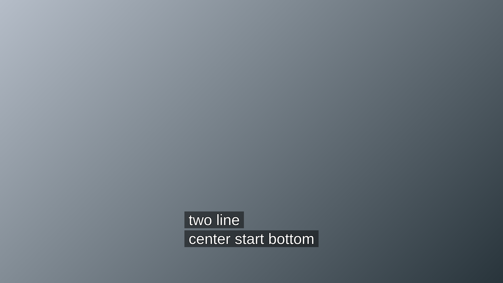


### subtitle e_40 at begin=01:02:45.120

#### div XML

```
<div xml:id="e_40" region="R0" begin="01:02:45.120" end="01:02:48.120" style="d_default">
   <p style="p_font2 p_al_center_start ps_bg_ghostboxedblack p_rb_res_outside"><span style="ps_bg_ghostboxedblack">two line</span><span><br/></span><span style="ps_bg_ghostboxedblack">center start bottom</span></p>
  </div>
```
#### Resulting Image

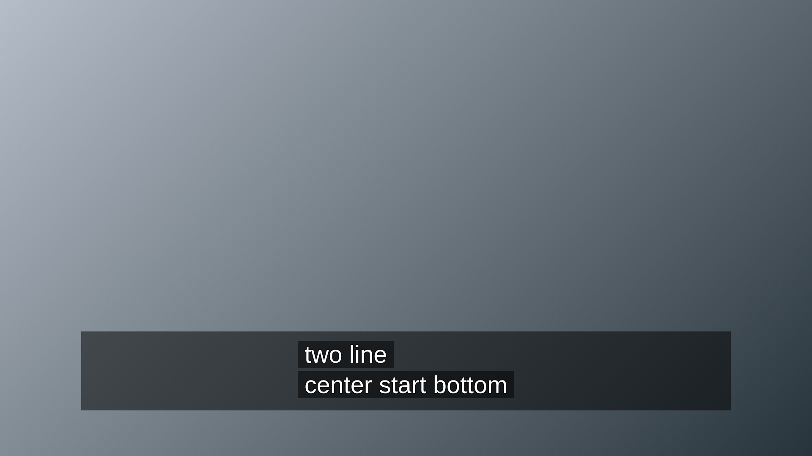


### subtitle e_42 at begin=01:02:50.120

#### div XML

```
<div xml:id="e_42" region="R0" begin="01:02:50.120" end="01:02:54.120" style="d_default">
   <p style="p_font2 p_al_center_start ps_bg_ghostboxedblack p_rtl p_rb_res_outside"><span style="ps_bg_ghostboxedblack">abc אותיות </span><span style="ps_bg_ghostboxedblack s_fg_red">bcd השימו 1983 ש</span><span><br/></span><span style="ps_bg_ghostboxedblack">center start bottom</span></p>
  </div>
```
#### Resulting Image


### subtitle e_43 at begin=01:02:55.120

#### div XML

```
<div xml:id="e_43" region="R0" begin="01:02:55.120" end="01:02:59.120" style="d_default">
   <p style="p_font2 p_al_center_start ps_bg_ghostboxedblack p_rtl p_rb_res_outside"><span style="ps_bg_ghostboxedblack">abc אותיות </span><span style="ps_bg_ghostboxedblack s_fg_red">bcd השימו 1983 ש</span><span><br/></span><span style="ps_bg_ghostboxedblack">center start bottom</span></p>
  </div>
```
#### Resulting Image

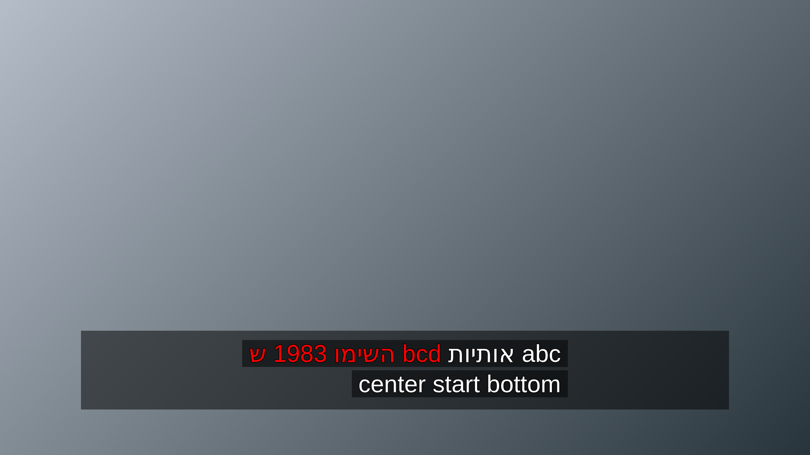


### subtitle e_44 at begin=01:03:00.120

#### div XML

```
<div xml:id="e_44" region="R0" begin="01:03:00.120" end="01:03:04.120" style="d_default">
   <p style="p_font2 p_al_center_start ps_bg_ghostboxedblack p_rtl p_rb_res_outside"><span style="ps_bg_ghostboxedblack">من البيان والتبيين الى</span><span style="ps_bg_ghostboxedblack s_fg_red"> البتاع والتبتيع</span><span><br/></span><span style="ps_bg_ghostboxedblack">center start bottom</span></p>
  </div>
```
#### Resulting Image


### subtitle e_45 at begin=01:03:05.120

#### div XML

```
<div xml:id="e_45" region="R0" begin="01:03:05.120" end="01:03:05.220" style="d_default">
   <p style="p_font2 p_al_center_start ps_bg_ghostboxedblack p_rtl p_rb_res_outside"><span style="ps_bg_ghostboxedblack">من البيان والتبيين الى</span><span style="ps_bg_ghostboxedblack s_fg_red"> البتاع والتبتيع</span><span><br/></span><span style="ps_bg_ghostboxedblack">center start bottom</span><span><br/></span><span style="ps_bg_ghostboxedblack">1  </span><span style="ps_bg_ghostboxedblack">2</span><span style="ps_bg_ghostboxedblack">3</span></p>
  </div>
```
#### Resulting Image


### subtitle e_45.2 at begin=01:03:05.220

#### div XML

```
<div xml:id="e_45.2" region="R0" begin="01:03:05.220" end="01:03:06.120" style="d_default">
   <p style="p_font2 p_al_center_start ps_bg_ghostboxedblack p_rtl p_rb_res_outside"><span style="ps_bg_ghostboxedblack">من البيان والتبيين الى</span><span style="ps_bg_ghostboxedblack s_fg_red"> البتاع والتبتيع</span><span><br/></span><span style="ps_bg_ghostboxedblack">center start bottom</span><span><br/></span><span style="ps_bg_ghostboxedblack">1  </span><span style="ps_bg_ghostboxedblack">2</span><span style="ps_bg_ghostboxedblack">3</span></p>
  </div>
```
#### Resulting Image


### subtitle e_45.5 at begin=01:03:06.120

#### div XML

```
<div xml:id="e_45.5" region="R0" begin="01:03:06.120" end="01:03:08.120" style="d_default">
   <p style="p_font2 p_al_center_start ps_bg_ghostboxedblack p_rtl p_rb_res_outside"><span style="ps_bg_ghostboxedblack">من البيان والتبيين الى</span><span style="ps_bg_ghostboxedblack s_fg_red"> البتاع والتبتيع</span><span><br/></span><span style="ps_bg_ghostboxedblack">center start bottom</span><span><br/></span><span style="ps_bg_ghostboxedblack">1  </span><span style="ps_bg_ghostboxedblack">2</span><span style="ps_bg_ghostboxedblack">3</span></p>
  </div>
```
#### Resulting Image


### subtitle e_46 at begin=01:03:10.359

#### div XML

```
<div xml:id="e_46" region="R0" begin="01:03:10.359" end="01:03:13.359" style="d_default">
   <p style="p_font2 p_rb_res_outside"><span>No Ruby </span><span style="s_rb_algn_center"><span style="s_rb_b">Ruby Above </span><span style="s_rb_t">ruby</span></span><span style="s_rb_algn_center s_rb_posn_outside"><span style="s_rb_b">Ruby Above 2</span><span style="s_rb_t">ruby2</span></span><span><br/></span><span style="s_rb_algn_center s_rb_posn_outside"><span style="s_rb_b">Ruby Below </span><span style="s_rb_t">ruby</span></span><span style="s_rb_algn_center s_rb_posn_outside"><span style="s_rb_b">Ruby Below 2</span><span style="s_rb_t">ruby2</span></span></p>
  </div>
```
#### Resulting Image

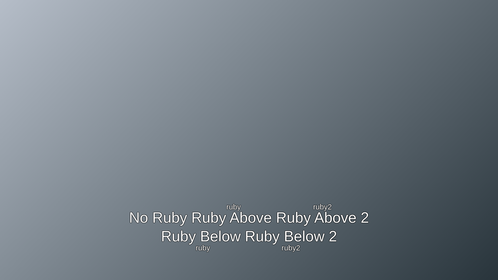


### subtitle e_47 at begin=01:03:14.359

#### div XML

```
<div xml:id="e_47" region="R0" begin="01:03:14.359" end="01:03:18.359" style="d_default">
   <p style="p_font2 p_rb_res_outside"><span>No Ruby Above No Ruby Above 2</span><span><br/></span><span>No Ruby Below No Ruby Below 2</span></p>
  </div>
```
#### Resulting Image

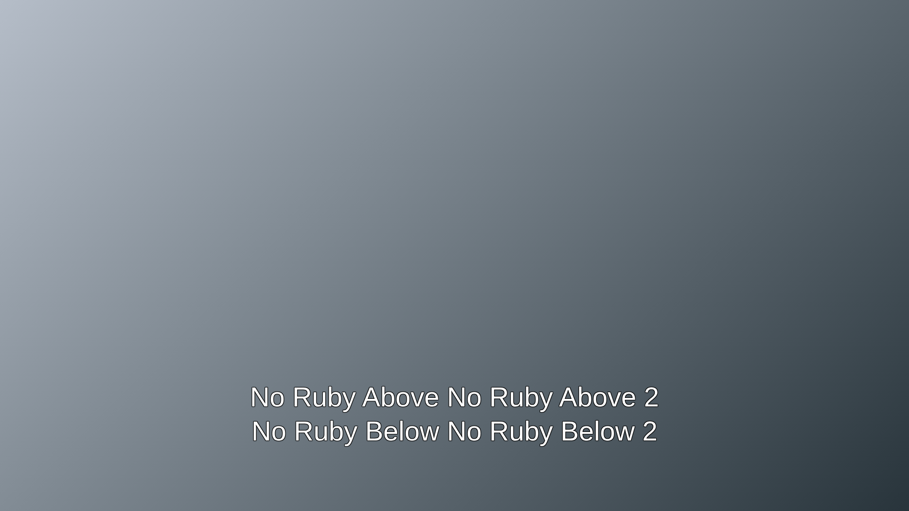


### subtitle e_48 at begin=01:03:20.359

#### div XML

```
<div xml:id="e_48" region="R12" begin="01:03:20.359" end="01:03:24.359" style="d_default">
   <p style="p_font2 p_rb_res_outside p_shear"><span style="s_combine">84</span><span style="s_combine">1984</span><span style="s_rb_algn_center s_rb_posn_outside"><span style="s_rb_b s_emf_fco">東南</span><span style="s_rb_t">とうなん</span></span><span><br/></span><span style="s_rb_algn_center s_rb_posn_outside"><span style="s_rb_b s_emf_fco">東南</span><span style="s_rb_t">たつみ</span></span><span style="s_emf_fco">No Ruby</span></p>
  </div>
```
#### Resulting Image


### subtitle e_49 at begin=01:03:25.359

#### div XML

```
<div xml:id="e_49" region="R12" begin="01:03:25.359" end="01:03:29.359" style="d_default">
   <p style="p_font2 p_rb_res_outside p_shear"><span style="s_combine ps_bg_ghostboxedblack">1984</span><span style="s_rb_algn_center s_rb_posn_outside ps_bg_ghostboxedblack"><span style="s_rb_b s_emf_fco">東南</span><span style="s_rb_t">とうなん</span></span><span><br/></span><span style="s_rb_algn_center s_rb_posn_outside ps_bg_ghostboxedblack"><span style="s_rb_b s_emf_fco"> 東南</span><span style="s_rb_t">たつみ</span></span><span style="s_emf_fco ps_bg_ghostboxedblack">No Ruby Boxed</span></p>
  </div>
```
#### Resulting Image


### subtitle e_50 at begin=01:03:30.420

#### div XML

```
<div xml:id="e_50" region="R0" begin="01:03:30.420" end="01:03:31.420" style="d_default">
   <p style="p_font2 p_al_center_start p_rtl p_rb_res_outside"><span style="ps_bg_ghostboxedblack">من البيان والتبيين الى</span><span style="ps_bg_ghostboxedblack s_fg_red"> البتاع والتبتيع</span></p>
   <p style="p_font2 p_al_center_start p_rb_res_outside"><span style="ps_bg_ghostboxedblack">left to right.</span><span><br/></span><span style="ps_bg_ghostboxedblack">1      </span><span style="ps_bg_ghostboxedblack">2</span><span style="ps_bg_ghostboxedblack">3</span></p>
  </div>
```
#### Resulting Image

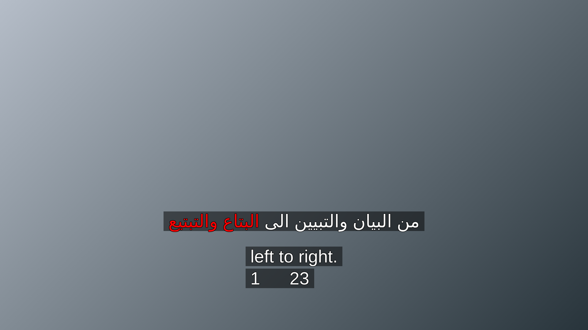


### subtitle e_53 at begin=01:03:34.359

#### div XML

```
<div xml:id="e_53" region="R0" begin="01:03:34.359" end="01:03:36.359" style="d_default">
   <p style="p_font2 p_rb_res_outside p_shear"><span style="s_combine">84</span><span>1984</span></p>
  </div>
```
#### Resulting Image


### subtitle e_54 at begin=01:03:37.359

#### div XML

```
<div xml:id="e_54" region="R12" begin="01:03:37.359" end="01:03:39.359" style="d_default">
   <p style="p_font2 p_rb_res_outside"><span style="s_emf_fco">東南</span><span><br/></span><span style="s_emf_fso">Emph Outside</span></p>
  </div>
```
#### Resulting Image


### subtitle e_55 at begin=01:03:40.359

#### div XML

```
<div xml:id="e_55" region="R12" begin="01:03:40.359" end="01:03:41.359" style="d_default">
   <p style="p_font2 p_rb_res_outside"><span style="s_combine">1984</span><span style="s_rb_algn_center"><span style="s_rb_b s_emf_fco">東南</span><span style="s_rb_t">とうなん</span></span><span><br/></span><span style="s_rb_algn_center s_emf_fco"><span style="s_rb_b">東南</span><span style="s_rb_t">たつみ</span></span><span style="s_emf_fco">No Ruby</span></p>
  </div>
```
#### Resulting Image


